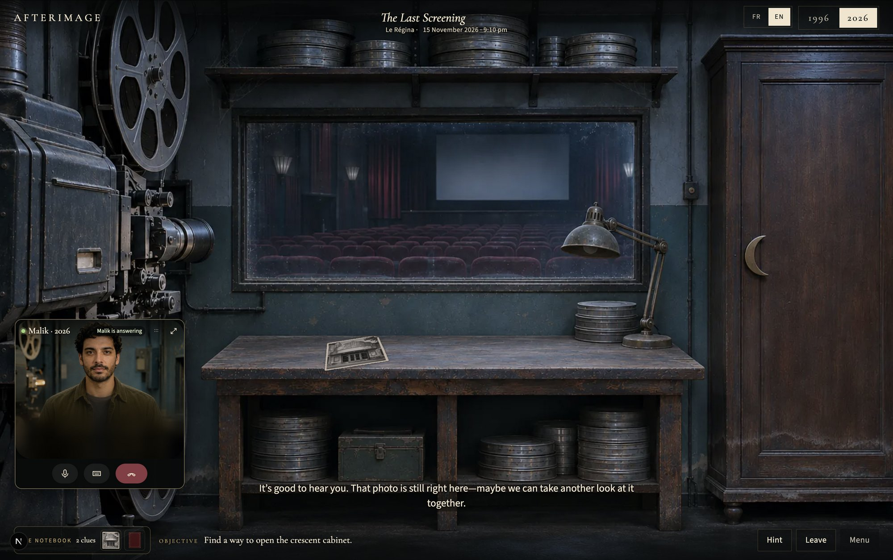
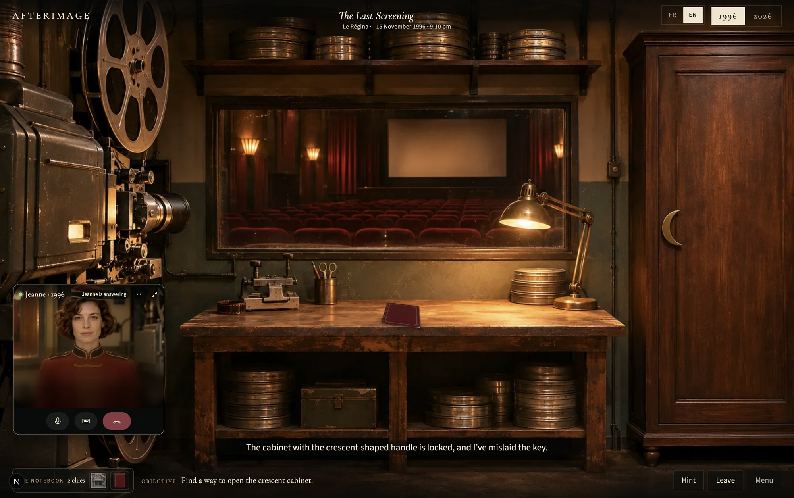

# AFTERIMAGE — La dernière séance

> Deux personnes. Le même cinéma. Trente ans d’écart. Parlez-leur, gagnez leur confiance et faites traverser le temps à ce qui mérite d’être sauvé.

A conversational mystery for the **Napster API Ignite 2026 hackathon**, live at **[afterimage-vert.vercel.app](https://afterimage-vert.vercel.app)**. You talk by video and voice (or by keyboard) to **Jeanne**, a projectionist in 1996, and **Malik**, an archivist in the same projection booth in 2026. They never meet: you are their only link. A clue found in 2026 lets Jeanne act in 1996. What she preserves in 1996 is found in 2026, including **a sentence you wrote yourself**, recovered word for word. Then you decide how to honour the filmmaker's promise (3 endings).

| **2026 — Malik (Archivist)** | **1996 — Jeanne (Projectionist)** |
|---|---|
|  |  |
| *Le Régina, 15 November 2026 — cold, dusty booth with Malik in live video PiP* | *Le Régina, 15 November 1996 — warm amber booth with Jeanne in live video PiP* |

Built from the production kit `afterimage-kit-v1` (bible, data, art). The kit's master document is in `docs/kit/` *(spoiler warning: play first before reading the kit or technical docs!)*.

## What works today (honestly)

| Area | Status |
|---|---|
| Production deployment (Vercel + Turso Cloud libSQL) | ✅ live at [afterimage-vert.vercel.app](https://afterimage-vert.vercel.app) (single production project, `NAPSTER_MAX_ACTIVE=3`, HTTPS & live smoke verified; remaining: GitHub auto-deploy link, full multi-ending/Safari acceptance, CSP review) |
| Full chapter (3 puzzles, 3 endings, exact personal message, hints, resume) | ✅ in rehearsal mode and live; e2e-tested in a browser (rehearsal) |
| **Live Napster conversation** (WebRTC video + voice, per-run context, implicit tools → server-validated mutations → character reaction) | ✅ tested locally and on production (see `docs/NAPSTER_ACCESS_REPORT.md`) |
| **Custom Companion V2 avatars** | ✅ active on all 4 story agents (generated from the kit portraits; V1 kept as fallback) |
| Rehearsal mode without any key or network call | ✅ labelled everywhere as « Mode répétition » / « Rehearsal mode » |
| Auth (guests, invitation-only accounts), tenant/owner isolation, transactional engine, idempotency, distributed capacity | ✅ unit + integration tests |
| Admin (members, invitations, capacity/sessions, version) | ✅ minimal |
| French & English | ✅ both active end to end (UI, episode documents, hints, tools and 100% locale-matched agents; admin/privacy pages stay French; English copy pending native review) |
| VHS recording, phone epilogue | ⛔ disabled: Recordings not enabled on the account (403), phone not tested |

The kit portraits are used both as static fallbacks and as the source artwork for the live Napster Companion V2 video avatars of Jeanne and Malik.

## Install (local)

Requires Node ≥ 22.12 (tested on 24) and npm.

```bash
npm ci
npm run setup      # asks: rehearsal (no account) or live Napster; creates .env.local, SQLite, migrations, demo tenant
npm run dev        # http://localhost:3000
```

- `setup` is idempotent: it never overwrites `.env.local`, never prints secrets, never creates Napster resources.
- Live mode: put `NAPSTER_API_KEY` in `.env.local` (or `.env`), set `CONVERSATION_MODE=live`, then `npm run doctor`. Agent ids come from `config/napster-resources.json`.
- Owner for the admin: `npm run ops:bootstrap-owner -- --email=you@example.com` prints a one-time local link.

## Scripts

| Command | What it does |
|---|---|
| `npm run setup` / `dev` / `build` / `start` | install · dev server · production build (no DB/Napster access at build) · serve |
| `npm run doctor` | sanitized diagnostics (names, never values; read-only Napster agent check in live mode) |
| `npm run db:generate` / `db:migrate` / `db:seed` | Drizzle migrations (generate) · apply locally · idempotent seed |
| `npm run release:migrate -- --confirm=<env>` | release job for a remote libSQL DB (staging/production) |
| `npm test` / `test:integration` / `test:e2e` | unit (engine, projections, tools) · HTTP routes on real SQLite + Better Auth · Playwright on a production build |
| `npm run lint` / `typecheck` / `verify` | ESLint · tsc · all of the above + build |
| `npm run provision:napster [-- --locale=fr\|en] [-- --apply]` | explicit, idempotent Napster provisioning (dry run by default; reuses the 4 agents) |
| `npm run ops:cleanup` | lease reconciliation + retention purge (same code as the cron) |
| `npm run ops:napster-usage` | Napster sessions and summed cost (budget tracking) |
| `npm run ops:bootstrap-owner -- --email=…` | one-time owner invitation link |
| `npm run assets:build` | WebP variants of the kit artwork (originals in `assets-src/`) |
| `node tests/live/proof.mjs` / `tests/live/game-live.mjs` | live Napster proofs (consume credits; dev server in live mode) |

## Architecture in one paragraph

Next.js 16 (App Router, Node runtime) · TypeScript strict · Drizzle + `@libsql/client` (SQLite file locally, Turso **libSQL** remotely) · Better Auth (anonymous guests, invitation-only email sign-up) · Napster Web SDK 2.0.0 over WebRTC. The **server engine decides**: buttons, keyboard and model tool calls all become the same bounded commands, validated (auth → membership → ownership → Zod → lease → prerequisites) and applied in one write transaction (snapshot + event + idempotency receipt, CAS on revision). Napster is never called inside a transaction. Each character only receives its own projection of the run; agents' global prompts are immutable. Details: `docs/ARCHITECTURE.md`, decisions: `docs/DECISIONS.md`.

## Deploy

Production is deployed on **Vercel** (`https://afterimage-vert.vercel.app`) backed by **Turso Cloud** (`libSQL`, via the Vercel Marketplace integration). See `docs/OPERATIONS.md` for environment variables, release migrations, backup/restore, rollback and remaining acceptance checks. Security evidence: `docs/SECURITY_CHECKLIST.md`.

## AI assistance

Built with AI assistance, disclosed as the hackathon rules require: the game kit (story, data, art direction, generated artwork) was produced with ChatGPT; the code was written with Claude Code. Direction, decisions and review are the author's.
