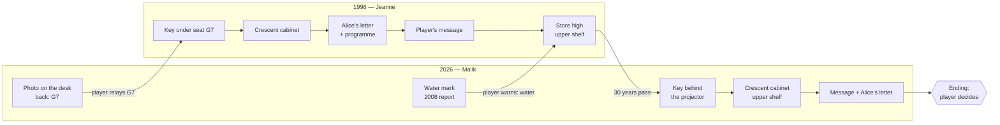
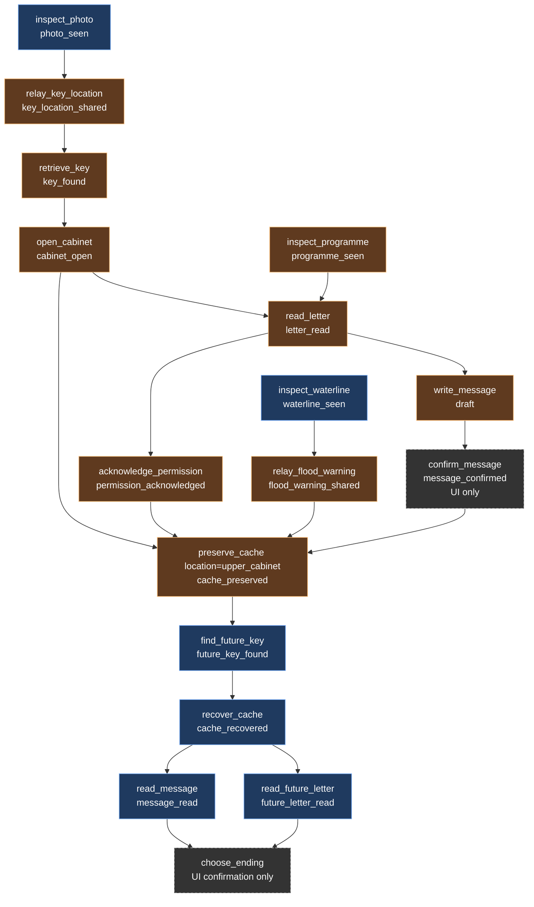
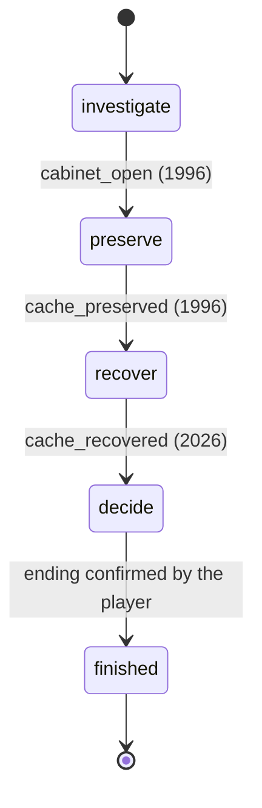
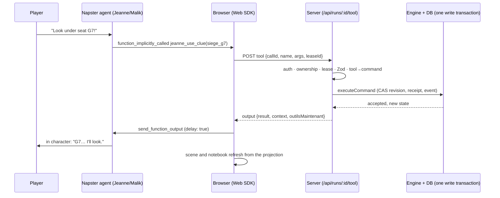

# Game logic — La dernière séance

How the episode works, generated from the code (`src/server/world/engine.ts`,
`src/server/napster/tools.ts`, `src/content/episodes/last-screening/v1/`). The engine is pure
and authoritative: characters and the player only *propose* actions; the engine accepts or
refuses them. Diagrams use Mermaid (GitHub renders them).

## 1. The story in one picture

Two eras share one projection booth. The player talks with **Jeanne** (1996, the last night
before the cinema closes) and **Malik** (2026, thirty years later). Neither can see the other's
era: the player carries clues between them.

## 2. The three puzzles

| # | Puzzle | Where the clue is | Who acts | What unlocks |
|---|---|---|---|---|
| 1 | **The key** | Back of the photo in 2026: "G7" | Jeanne searches under seat G7 | The 1996 cabinet opens → the letter |
| 2 | **The cache** | Water mark + 2008 report in 2026 (damage at desk level) | Jeanne stores the film on the upper shelf | The film and the message survive 30 years |
| 3 | **The promise** | Alice's letter (1996): the epilogue stays private | Player acknowledges, writes a message, then chooses the ending | Three possible endings |

In 2026, Malik must first find the key **behind the projector** (`find_future_key`); only then can he open the cabinet that Jeanne sealed.

## 3. Dependency graph (flags)

Each box is an engine action; each arrow is a prerequisite flag. Colour = era.

## 4. Actions: era, prerequisites, effect

| Action | Era | Requires | Sets | Who can trigger |
|---|---|---|---|---|
| `inspect_photo` | 2026 | — | `photo_seen` | UI, Malik |
| `inspect_waterline` | 2026 | — | `waterline_seen` | UI, Malik |
| `relay_key_location` | 1996 | `photo_seen` | `key_location_shared` | UI, Jeanne |
| `retrieve_key` | 1996 | `key_location_shared` | `key_found` | UI, Jeanne |
| `open_cabinet` | 1996 | `key_found` | `cabinet_open` | UI, Jeanne |
| `inspect_programme` | 1996 | — | `programme_seen` | UI, Jeanne |
| `read_letter` | 1996 | `cabinet_open`, `programme_seen` | `letter_read` | UI, Jeanne |
| `acknowledge_permission` | 1996 | `letter_read` | `permission_acknowledged` | UI, Jeanne (player agrees by voice) |
| `relay_flood_warning` | 1996 | `waterline_seen` | `flood_warning_shared` | UI, Jeanne |
| `write_message` | 1996 | `letter_read`, not yet preserved | draft (1–240 chars, normalized) | UI, Jeanne |
| `confirm_message` | 1996 | draft equal to the shown text | `message_confirmed` | **UI only** |
| `preserve_cache` | 1996 | `cabinet_open`, `permission_acknowledged`, `flood_warning_shared`, `message_confirmed` | `cache_preserved` (only `upper_cabinet`; other places → `WRONG_LOCATION`) | UI, Jeanne |
| `find_future_key` | 2026 | `cache_preserved` | `future_key_found` | UI, Malik |
| `recover_cache` | 2026 | `future_key_found` | `cache_recovered` | UI, Malik |
| `read_message` | 2026 | `cache_recovered` | `message_read` | UI, Malik |
| `read_future_letter` | 2026 | `cache_recovered` | `future_letter_read` | UI, Malik |
| `choose_ending` | 2026 | `cache_recovered`, `message_read`, `future_letter_read` | `ending` | **UI confirmation token only** |
| `switch_era` | any | no live conversation open | `activeEra` | **UI only** |
| `request_hint` | any | game not finished | next hint level on the current topic | UI, both characters |

After the message is preserved it is locked (`MESSAGE_LOCKED`): the past cannot be rewritten.

## 5. Phases

## 6. Refusals (what the character hears)

| Code | When | Text returned (en; fr in `texts.ts`) |
|---|---|---|
| `WRONG_ERA` | The action belongs to the other era | "This action is not possible in this era." |
| `PREREQUISITE_MISSING` | A required flag is missing | A precise, in-character reason (e.g. "the cabinet is locked, no key") |
| `WRONG_LOCATION` | Film stored somewhere other than the upper shelf | Why that place is risky + a suggestion |
| `WRONG_CHARACTER` | Jeanne's tool in 2026, or Malik's in 1996 | "This action cannot come from this character." |
| `UI_CONFIRMATION_REQUIRED` | A model tried to confirm the message, switch era or choose the ending | "You confirm this decision yourself, on screen." |
| `MESSAGE_LOCKED` | Editing the message after it was preserved | "The message is already sealed with the film…" |
| `RUN_FINISHED` | Any action after the ending | — |

## 7. Characters and their tools

The model never sees engine actions directly: each character has a closed list of tools,
validated with Zod and mapped to one engine command. English agents use the same tools
prefixed `en_` with English argument values.

| Tool | Arguments | Engine action |
|---|---|---|
| `jeanne_examine` | `objet: programme \| lettre` | `inspect_programme` / `read_letter` |
| `jeanne_use_clue` | `indice: siege_g7 \| risque_eau` | `relay_key_location` / `relay_flood_warning` |
| `jeanne_act` | `geste: chercher_cle \| ouvrir_armoire \| noter_accord \| conserver`, `emplacement?` | `retrieve_key` / `open_cabinet` / `acknowledge_permission` / `preserve_cache` |
| `jeanne_draft_message` | `texte` | `write_message` |
| `malik_examine` | `objet: photo \| trace_eau \| message \| lettre` | `inspect_photo` / `inspect_waterline` / `read_message` / `read_future_letter` |
| `malik_act` | `geste: chercher_cle \| ouvrir_armoire` | `find_future_key` / `recover_cache` |
| `world_request_hint` | — | `request_hint` |

### What each character knows

| | Jeanne (1996) | Malik (2026) |
|---|---|---|
| At the start | The cinema closes tonight; Alice Mercier's film; she cancelled the screening; a promise to keep; the cabinet holds the film and the letter; she lost the key | 15 Nov 2026; no film for 30 years; the last screening was cancelled; a lost film by Alice; a photo and a water mark on the desk; no key for the cabinet |
| Learned during play | programme → the cancellation was deliberate; letter → a version without the epilogue is allowed; G7 from the player; the water risk from the player | photo → G7; water mark → 2008 damage at desk level; after 1996 preservation → "a new object is detectable"; key behind the projector; reel, envelope and message |
| Never knows | G7 before the player says it; the future | What happened in 1996 until it is in the cabinet |

Knowledge is projected per character (`characterContext`) and sent only through
`externalClientProfile`, tool outputs and system messages. The agents' global prompts never
contain player data.

## 8. Endings

| Ending | Choice | Promise to Alice |
|---|---|---|
| `public_cut` | Screen the authorised version (no epilogue) | Kept |
| `sealed_archive` | Entrust the film to the archives, no screening | Kept |
| `broken_promise` | Screen everything despite the letter | Broken (its confirmation states the betrayal) |

The ending is chosen in the UI, then confirmed with a single-use token
(`ending-intent` → `ending`). A character can talk about the choice but never make it.

## 9. Hints

Three levels per topic, requested by the player (button or by voice). The topic follows the
progress:

| Situation | Topic |
|---|---|
| The 1996 cabinet is still closed | `key` |
| Letter not read or permission not acknowledged | `promise` |
| Cache not preserved yet | `cache` |
| Afterwards | `promise` |

## 10. One action, end to end

Napster is never called inside the transaction; a repeated `callId` returns the stored
receipt instead of acting twice.
